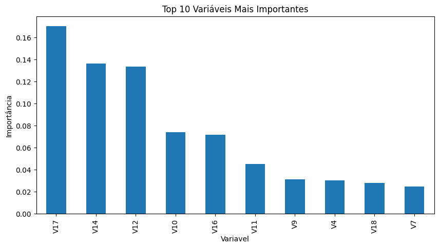
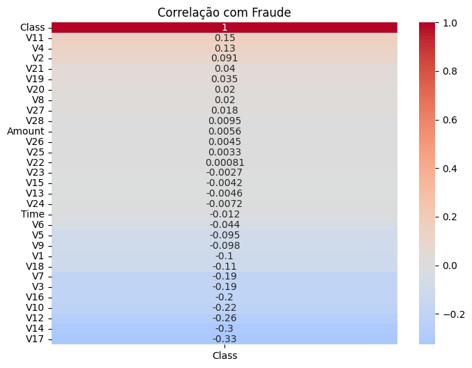
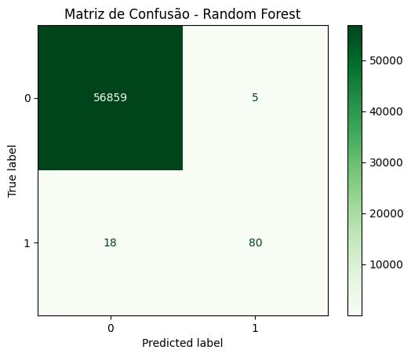

# Detecção de Fraudes em Cartões de Crédito utilizando Machine Learning

## Objetivo

Desenvolver modelos capazes de identificar transações financeiras fraudulentas utilizando técnicas de Ciência de Dados e Machine Learning.

## Dataset

O conjunto de dados contém:

- 284.807 transações
- 31 variáveis
- 492 registros classificados como fraude
- Forte desbalanceamento entre as classes

## Etapas do Projeto

### 1. Análise Exploratória dos Dados (EDA)

- Verificação de valores nulos
- Estatísticas descritivas
- Análise dos valores das transações
- Identificação de outliers
- Correlação entre variáveis

### 2. Tratamento do Desbalanceamento

Aplicação da técnica SMOTE para balanceamento da classe minoritária.

### 3. Modelagem

Modelos avaliados:

- Regressão Logística
- Regressão Logística + SMOTE
- Random Forest

## Resultados

| Modelo | Precision | Recall | F1-Score |
|----------|----------|----------|----------|
| Regressão Logística | 84% | 69% | 76% |
| Regressão Logística + SMOTE | 12% | 90% | 21% |
| Random Forest | 94% | 82% | 87% |

## Variáveis Mais Importantes

- V17
- V14
- V12
- V10
- V16

## Conclusão

O modelo Random Forest apresentou o melhor equilíbrio entre detecção de fraudes e redução de falsos positivos.

Resultados finais:

- Precision: 94%
- Recall: 82%
- F1-Score: 87%

O projeto demonstrou a importância do tratamento de classes desbalanceadas e da avaliação cuidadosa das métricas em problemas de fraude financeira.

## Tecnologias Utilizadas

- Python
- Pandas
- NumPy
- Seaborn
- Matplotlib
- Scikit-Learn
- Imbalanced-Learn (SMOTE)

## Arquivos

- Notebook completo da análise
- Relatório em PDF
- Resultados dos modelos

- ## Visualizações

### Importância das Variáveis

### Heatmap de Correlação

### Matriz de Confusão - Random Forest

